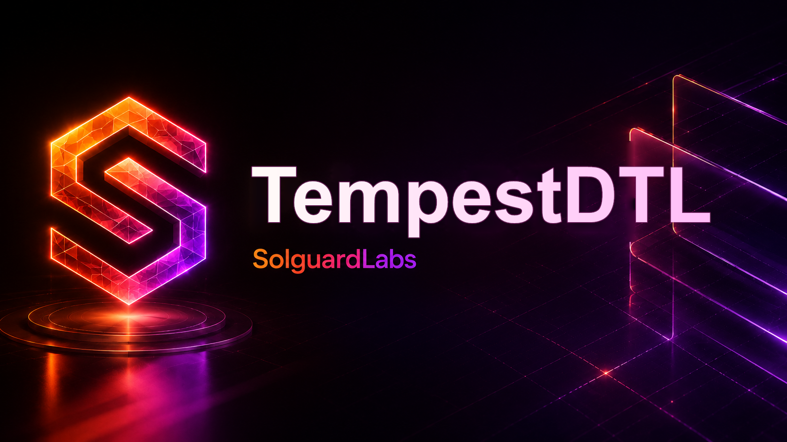

# TempestDTL



TempestDTL es un router Rust para rutas DTL con control de volatilidad, limites
de desviacion y pausas operativas cuando la liquidez cambia de forma brusca. El
proyecto modela una red de mercados con pools multi-activo, oraculos internos,
perfiles de riesgo, tickets de ruta y liquidacion determinista.

## Componentes

- `oracle`: observa precios, profundidad y cambios relativos por mercado.
- `liquidity`: mantiene pools, reservas, quoting y ejecucion de hops.
- `risk`: aplica limites de desviacion, volatilidad, liquidez minima y TTL.
- `pause`: coordina los modos operativo, pausa y recuperacion.
- `routes`: crea tickets de ruta con parametros economicos admitidos.
- `settlement`: liquida tickets contra el ledger y los pools.
- `runtime`: expone escenarios reproducibles para pruebas de integracion.

## Requisitos

- Rust 1.96 o superior.
- Node.js 24 o superior.

## Uso

```bash
cargo run -- normal
cargo run -- volatility
cargo run -- pause
cargo run -- reactivation
cargo run -- ticket
```

Cada escenario imprime un objeto JSON estable con el estado final, eventos,
balances, modo operativo y digests de auditoria.

## Tests

```bash
cargo test --locked
node --test "tests/node/*.test.js"
bash scripts/tests.sh
```

La validacion completa de CI ejecuta formato, build, tests Rust, clippy y tests
JavaScript:

```bash
bash scripts/ci.sh
```

## Estructura

```text
src/
  accounts/
  asset/
  catalog/
  codec/
  events/
  ids/
  ledger/
  liquidity/
  oracle/
  pause/
  risk/
  routes/
  runtime/
  settlement/
tests/
  helpers/
  node/
scripts/
```

## Estado

Este repositorio esta preparado como laboratorio de auditoria de un sistema DTL
profesional. Los escenarios publicos cubren rutas normales, cambios de
volatilidad, pausa operativa y reactivacion.
