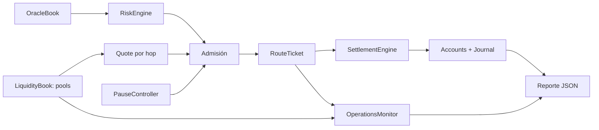
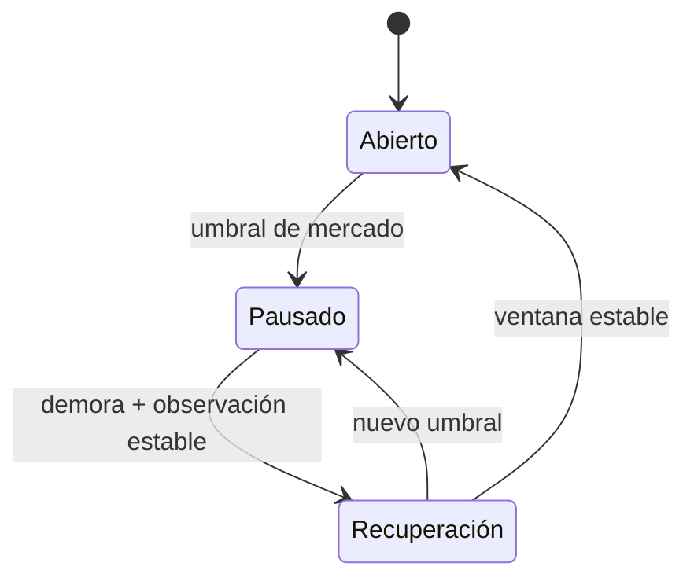

# TempestDTL


TempestDTL es un router DTL determinista en Rust para corredores multiactivo. Combina pools de liquidez, observaciones de mercado, perfiles de riesgo, tickets de ruta y un controlador de pausa operativa. La CLI publica escenarios JSON reproducibles; la biblioteca permite integrar el motor en servicios que necesitan un diario, recibos y telemetría de rutas pendientes.

## Arquitectura



Los mercados del ejemplo son `SOL-USDC` y `SOL-EURC`. Una ruta convierte USDC → SOL → EURC; cada hop conserva su mercado, importes, tarifa, reservas observadas y un digest. El ticket incluye la ventana temporal y el perfil de admisión. El recibo de liquidación y el diario permiten reconciliar saldos y actividad por slot.

## Cálculo y controles

Para un hop de entrada exacta, tras la tarifa `fee = floor(input × fee_bps / 10.000)`, la salida se calcula con reservas del pool:

```text
input_neto = input - fee
output = floor(input_neto × reserva_salida / (reserva_entrada + input_neto))
```

El motor valida continuidad de activos, máximo de hops, profundidad, puntuación de liquidez, volatilidad y TTL. El controlador de pausa cierra la admisión de rutas cuando las observaciones superan umbrales y requiere una ventana estable para recuperar el modo abierto. La telemetría `OperationsMonitor` resume tickets preparados/liquidados y compromisos por mercado y dirección sin mutar pools ni cuentas.



## Ejecución

Requiere Rust 1.96 y Node.js 24 para la suite cruzada. Desde la raíz:

```bash
cargo build --all-targets --locked
cargo test --locked
cargo run --quiet --locked -- normal
cargo run --quiet --locked -- queued
node --test "tests/node/*.test.js"
```

`queued` prepara dos rutas y muestra el pipeline de los dos mercados sin liquidarlas. `normal`, `volatility`, `pause`, `reactivation` y `ticket` cubren otros estados operativos. El conjunto de CI se reproduce con `bash scripts/ci.sh` en un entorno que tenga Rust y Node.

## Documentación

- [Arquitectura y estados](docs/arquitectura.md)
- [Modelo económico y ejemplos](docs/modelo-economico.md)
- [Operación y observabilidad](docs/operacion.md)
- [Contrato JSON](docs/contrato-json.md)
- [Política de seguridad](SECURITY.md)

La versión `1.0.0` identifica la interfaz publicada. `main`, la rama `production` y el tag anotado `v1.0.0` se comprueban contra el mismo commit; una release no implica conexión con redes, custodios ni fondos externos.
