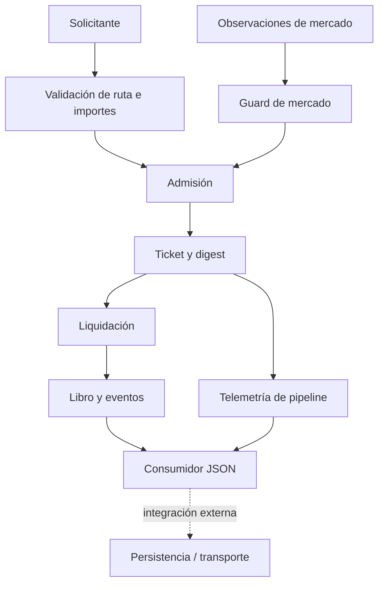

# Política de seguridad de TempestDTL

## Modelo de confianza

El router opera sobre catálogos, observaciones y pools suministrados por sus operadores. El núcleo no autentica fuentes externas, no custodia claves y no transmite transacciones por red. Una integración debe validar procedencia de observaciones, permisos de configuración, persistencia y exclusión concurrente de liquidaciones.



## Propiedades verificables

- Las cantidades usan enteros `i128` no negativos y operaciones comprobadas antes de multiplicar o restar reservas.
- El motor limita longitud de ruta y evalúa profundidad, puntuación, volatilidad y desviación según el perfil aplicable del catálogo.
- La pausa bloquea nuevas admisiones; la recuperación exige pasos de slot y estabilidad observada.
- Las liquidaciones rechazan tickets ya liquidados o expirados y generan recibos, eventos y entradas de diario.
- `OperationsMonitor` agrega compromisos preparados por `(mercado, activo origen, activo destino)`; no mezcla unidades de activos distintos ni altera el estado.
- CI verifica formato, compilación, pruebas Rust/Node y Clippy. La integridad de release exige igualdad de commit entre `main`, `production` y tag anotado.

## Reporte de incidencias

No publique secuencias sensibles ni datos de terceros en incidencias abiertas. Un reporte privado debe adjuntar commit, catálogo/perfiles aplicados, slots y observaciones ordenadas, ruta y ticket, reservas antes/después, recibo, diario y efecto económico cuantificado. Distinga el estado interno de cualquier transferencia de una integración externa. Preserve las salidas originales para permitir una regresión determinista.

## Validación local

```bash
bash scripts/ci.sh
cargo run --quiet --locked -- queued
```

Consulte [modelo económico](docs/modelo-economico.md) y [contrato JSON](docs/contrato-json.md) para unidades y semántica de los reportes.
