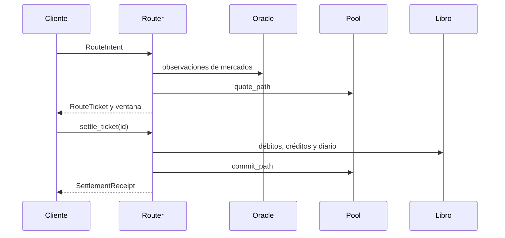

# Arquitectura y ciclo de rutas

`Router` orquesta cinco dominios: `OracleBook` conserva observaciones y versiones; `LiquidityBook` mantiene pools y quotes por hop; `RiskEngine` aplica perfil de admisión; `PauseController` modela modo operativo y recuperación; `SettlementEngine` registra pagos, movimientos y recibos. `OperationsMonitor` lee tickets y pools para elaborar un reporte de pipeline. Los digests de estado y ticket permiten comparar ejecuciones deterministas.

## Estado y época

El reloj lógico `slot` ordena admisiones, observaciones y liquidaciones. Una `RouteTicket` tiene estado `Prepared` o `Settled`, importes de extremo a extremo, hops, digest y fecha de expiración en slots. Los eventos registran aceptación, actualización de oráculo, entrada/salida de pausa, rechazo y liquidación. El reporte de operaciones agrupa exclusivamente tickets preparados por mercado y dirección; un ticket liquidado ya no figura en el pipeline.

## Límite de integración

La CLI crea un router nuevo para cada escenario, por lo que sus comandos no comparten saldos. Una integración persistente debe serializar por mercado y cuenta, dar identidad idempotente a órdenes, validar la fuente del oráculo y almacenar ticket, diario, observaciones y versión de catálogo en una transacción coherente. El motor no proporciona por sí solo autenticación, persistencia ni infraestructura de red.

La estructura fuente separa `catalog`, `risk`, `pause`, `routes`, `settlement`, `operations` y `runtime`. Las pruebas Rust cubren módulos; las pruebas Node ejecutan la CLI y validan el contrato JSON.
