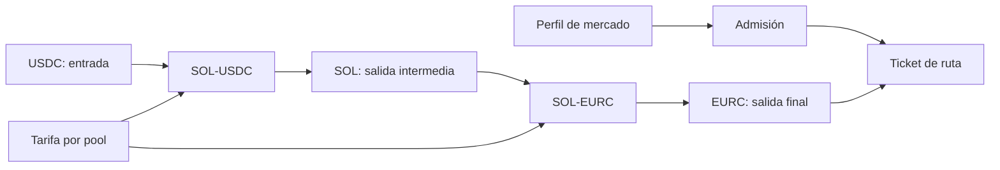

# Modelo económico y límites

## Cotización por hop

Las reservas de cada pool se mantienen como enteros no negativos. Para una entrada exacta `x` y tarifa `f` bps, se aplica `x_neto = x - floor(x × f / 10.000)`. Con reservas `(R_in, R_out)`, la salida es `floor(x_neto × R_out / (R_in + x_neto))`. Una ruta de dos hops usa la salida del primero como entrada del segundo. Las multiplicaciones y sumas se comprueban para evitar desbordamientos; el resultado no puede vaciar la reserva de salida.

El perfil de producción de la configuración base permite hasta cuatro hops, desviación máxima por defecto de 250 bps, volatilidad máxima por defecto de 650 bps, puntuación mínima de liquidez 70, profundidad mínima 20.000 y TTL por defecto de 12 slots. Los presets por mercado pueden estrechar esos límites; los valores efectivos del ticket provienen de las observaciones y el catálogo vigente al admitirlo.

## Indicadores de pipeline

`OperationsMonitor` separa direcciones: `SOL-USDC` en sentido USDC→SOL no se mezcla con SOL→USDC. Para cada grupo suma `input_units` y `output_units` de los hops de tickets preparados, cuenta rutas y registra el slot de admisión más antiguo. Como las cantidades pueden pertenecer a activos diferentes, no se suman entre grupos para producir un valor monetario global.

Ejemplo: dos tickets USDC→SOL→EURC preparados en el mismo slot producen dos líneas, una por mercado; cada línea tiene `prepared_routes = 2`. Al liquidarse ambos, `prepared_tickets = 0`, `settled_tickets = 2` y `market_pipeline` queda vacío. El reporte es observabilidad, no reserva de liquidez ni aprobación de liquidación.

## Modos operativos

Las observaciones de precio, profundidad y volatilidad alimentan el controlador de pausa. Una superación de umbral cierra la admisión y registra un evento. La transición a recuperación exige demora y ventana estable; otra ventana estable devuelve al modo abierto. El operador debe interpretar conjuntamente modo, slots, eventos y reporte de pipeline; ninguno de ellos, aislado, certifica la capacidad económica de un pool.
